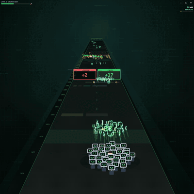

# Ship It! Indie Hacker Rush

[](LICENSE)
[](CONTRIBUTING.md)
<!-- ALL-CONTRIBUTORS-BADGE:START - Do not remove or modify this section -->
[](#contributors-)
<!-- ALL-CONTRIBUTORS-BADGE:END -->

A silly arcade runner for indie hackers. Squash bugs, close feature requests, park shiny ideas, recruit AI agents and beat the final boss of every side project: **Scope Creep**.

An arcade lane runner set inside a code editor, built around life as an indie hacker.

**▶ [Play it in your browser](https://eddiejaoude.github.io/ship-it-game/)**

<p align="center">
  
</p>

## Play

Play online at **https://eddiejaoude.github.io/ship-it-game/**, or clone the repo and open `index.html` in any modern browser. That's it.

- No build step, no dependencies, no backend, nothing saved.
- Everything (graphics, music, sound effects) is generated in code at runtime.
- Works on desktop (mouse or arrow keys) and mobile (drag).

## How to play

| | |
|---|---|
| Move | Mouse, `←` `→` / `A` `D`, or drag on touch screens |
| Shoot | Automatic |
| Green terminals | Recruit AI agents (`+5`, `x2`) |
| Red terminals | Lose agents. Shoot them to raise the number first |
| AI tokens | Collect to level up and pick an upgrade (`1` `2` `3`) |
| Pause | `P` / `Esc` |
| Music / SFX | `M` / `N` |

Enemies:

- 🐞 **Bugs** come in swarms and cost one agent each if they reach you
- 🎫 **Feature requests** are tanky and cost several agents
- 💡 **Shiny ideas** wobble around and distract your team
- 👾 **Scope Creep** (boss) sends feature requests, "quick call?" pings and bug swarms

The demo has 2 levels plus the boss. If you die during the boss fight you can retry straight from the boss.

## Customising

Open `index.html` and look near the top of the script:

- `CONFIG.repoUrl` shows a "Star on GitHub" button on the win screen when set
- `CONFIG.shareUrl` is the URL used in the "Ask for more levels" share post
- `FEATURES`, `IDEAS`, `BOSS_LINES`, `BG_TXT` hold all the jokes. PRs with better ones welcome
- `LEVELS` and `buildLevel()` define level length, speed and enemy patterns
- `UPGRADES` defines the level-up cards

### Difficulty

Enemy HP is defined as "seconds of your team's firepower" and is partly adaptive
(`hpFor()`), so the game stays tense whether you have 5 agents or 99. Team size is capped
at 99; overflow is converted into AI tokens.

`window.SHIPIT` exposes the game state in the browser console for tinkering.

## Ideas for more levels

- Level 3: Product Hunt Launch
- Level 4: Hacker News Hug of Death
- Level 5: The Series A Pitch
- Final boss: Big Tech Clones You

Want to build one? Check the [open issues](https://github.com/eddiejaoude/ship-it-game/issues) and the [contributing guide](CONTRIBUTING.md).

## Contributing

Contributions of all sizes are welcome, from a single joke to a whole new level. Read [CONTRIBUTING.md](CONTRIBUTING.md) to get started. This project follows the [Contributor Covenant Code of Conduct](CODE_OF_CONDUCT.md).

## Contributors ✨

Thanks to everyone who has helped ship it ([emoji key](https://allcontributors.org/docs/en/emoji-key)). Every kind of contribution counts, not just code: ideas, jokes, bug reports, testing, docs and design.

<!-- ALL-CONTRIBUTORS-LIST:START - Do not remove or modify this section -->
<!-- prettier-ignore-start -->
<!-- markdownlint-disable -->
<table>
  <tbody>
    <tr>
      <td align="center" valign="top" width="14.28%"><a href="https://eddiejaoude.substack.com/p/links"><br /><sub><b>Eddie Jaoude</b></sub></a><br /><a href="https://github.com/eddiejaoude/ship-it-game/commits?author=eddiejaoude" title="Code">💻</a> <a href="#design-eddiejaoude" title="Design">🎨</a> <a href="#ideas-eddiejaoude" title="Ideas, Planning, & Feedback">🤔</a> <a href="#maintenance-eddiejaoude" title="Maintenance">🚧</a> <a href="https://github.com/eddiejaoude/ship-it-game/commits?author=eddiejaoude" title="Documentation">📖</a> <a href="#infra-eddiejaoude" title="Infrastructure (Hosting, Build-Tools, etc)">🚇</a> <a href="https://github.com/eddiejaoude/ship-it-game/commits?author=eddiejaoude" title="Tests">⚠️</a> <a href="#content-eddiejaoude" title="Content">🖋</a></td>
    </tr>
  </tbody>
</table>

<!-- markdownlint-restore -->
<!-- prettier-ignore-end -->

<!-- ALL-CONTRIBUTORS-LIST:END -->

To add someone (or yourself), comment on an issue or PR:

```
@all-contributors please add @username for code, ideas
```

## License

[MIT](LICENSE) © Eddie Jaoude
